# Redub：录音转写与重新配音

> RN 笔试项目 · **Expo SDK 58 + React Native + TypeScript** · **Fish Audio API**

录制或导入一段 1–60 秒的语音 → 转写为文字 → 检查并编辑 → 选择目标声音 → 生成新的配音 → 对比试听、导出与分享；每次成功的配音自动保存到本地历史。iOS 与 Android 核心流程和交互一致，iOS 26 使用系统液态玻璃。

**快速入口**：[交付物清单](#1-交付物清单) · [演示视频](#2-演示视频与运行截图) · [安装与启动](#3-安装与启动) · [验收标准对照](#5-验收标准对照) · [AI 协作过程](#8-ai-协作过程)

---

## 1. 交付物清单

| # | 题目要求的交付物 | 本项目提供 |
|---|---|---|
| 1 | 项目源代码（不含测试凭据，提供依赖锁文件及配置示例） | 本仓库；`package-lock.json`；`.env.example`（API Key 通过 `.env.local` 注入，已被 `.gitignore` 忽略，提交前钩子会拦截密钥） |
| 2 | 全程编码录屏（覆盖开发过程与 AI 使用过程） | 由候选人通过网盘 / 邮件单独提交（录屏中可见 Claude Code 与 Codex 的使用过程，各阶段 Prompt 见 [`docs/reviews/`](docs/reviews/)） |
| 3 | iOS 与 Android 运行效果视频 | [`docs/demo/demo-ios.mp4`](docs/demo/demo-ios.mp4)（约 4 分钟）· [`docs/demo/demo-android.mp4`](docs/demo/demo-android.mp4)（约 5 分钟） |
| 4 | 项目说明文档（环境要求、安装与启动步骤） | 本 README；完整过程文档见 [`docs/`](docs/) |

## 2. 演示视频与运行截图

| 平台 | 视频 | 设备 |
|---|---|---|
| iOS | [demo-ios.mp4](docs/demo/demo-ios.mp4) | iPhone 16 模拟器 · iOS 26.3（液态玻璃） |
| Android | [demo-android.mp4](docs/demo/demo-android.mp4) | Pixel 9 模拟器 · Android 16 |

演示内容（两端相同）：录音（计时、电平波形、预览、使用此录音）→ 导入校验（超过 60 秒被拦截，原音源不变）→ 导入中文语音并转写 → 编辑并确认 → 试听并切换声音 → 生成配音 → 新配音与原音互斥播放 → 分享 / 导出 → 模拟服务错误后重试成功 → 历史详情 → 重新开始。

> 视频由 Maestro 自动操作（[`.maestro/demo/demo-full.yaml`](.maestro/demo/demo-full.yaml)）并用模拟器录屏，**不含声音**。Android 模拟器无法录入宿主机播放的声音，因此 Android 视频中的录音段落展示的是"未识别到有效语音"分支。

**iOS（真实运行截图）**

| 首页 | 录音 | 编辑文字 | 选择声音 | 生成结果 | 历史 | 结果已过期 |
|---|---|---|---|---|---|---|
| 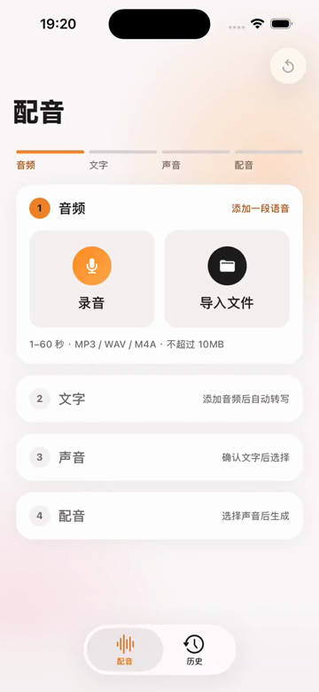 | 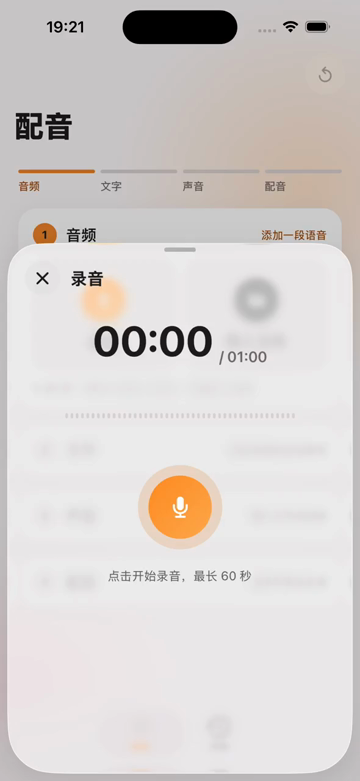 | 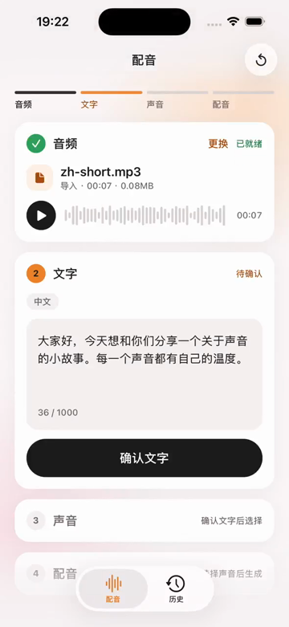 | 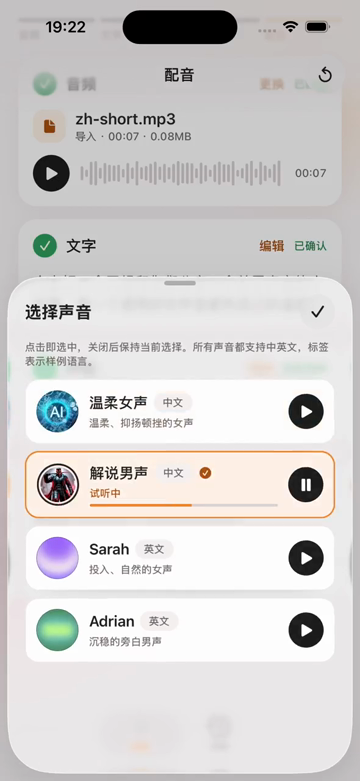 | 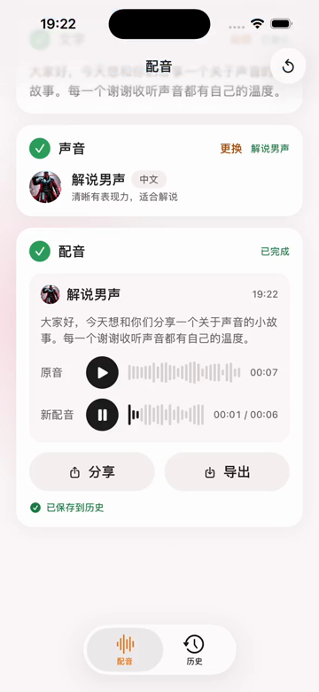 | 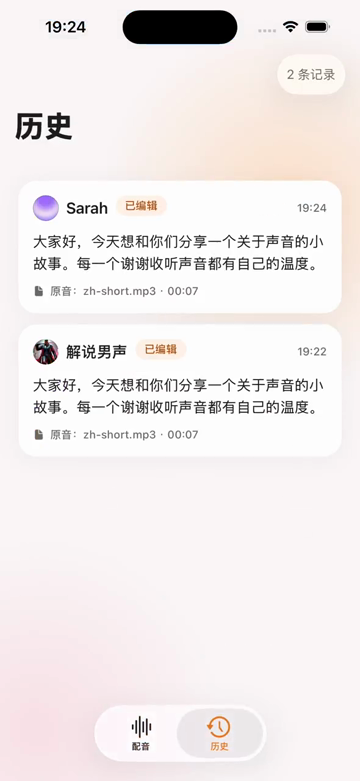 | 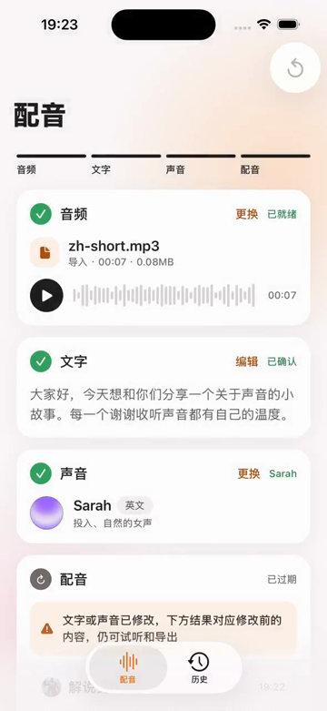 |

**Android（真实运行截图）**

| 首页 | 录音 | 编辑文字 | 选择声音 | 生成结果 | 历史 | 异常与重试 |
|---|---|---|---|---|---|---|
| 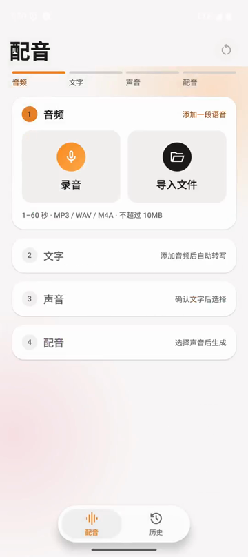 | 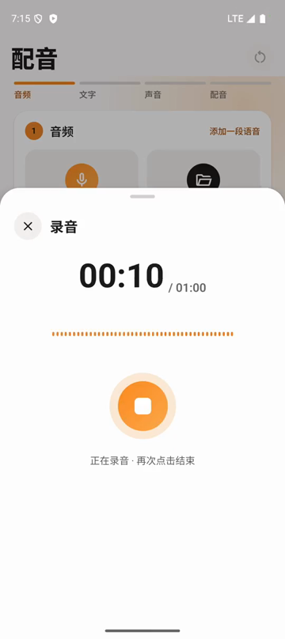 | 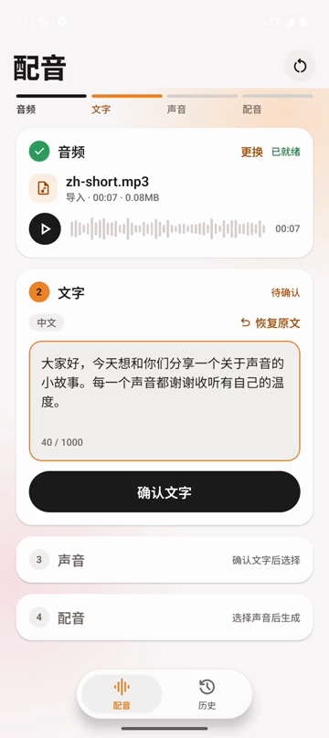 | 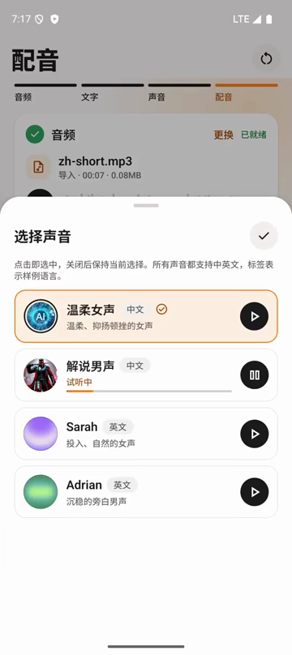 | 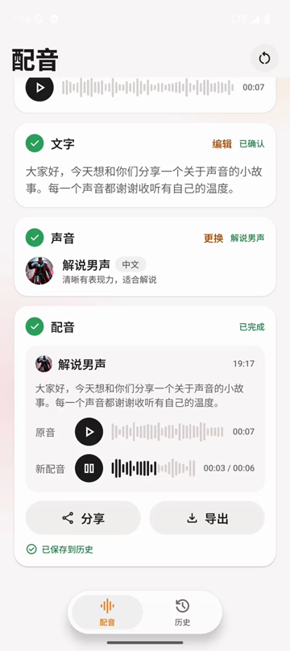 | 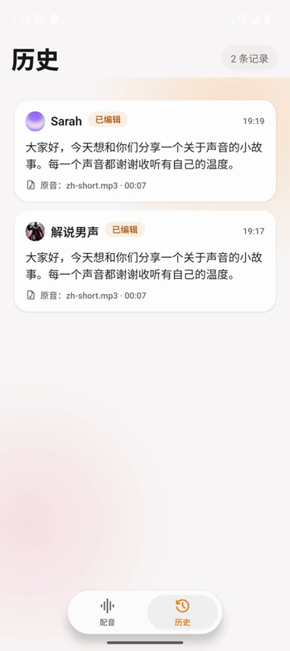 | 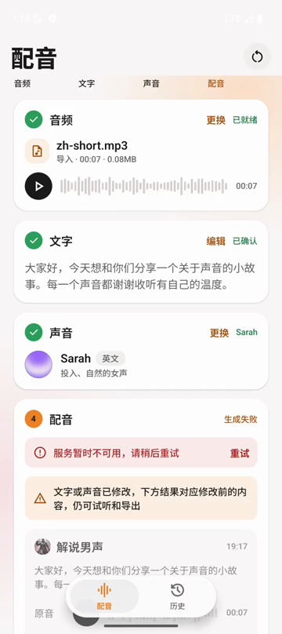 |

## 3. 安装与启动

### 3.1 环境要求

| 项 | 版本 |
|---|---|
| macOS | 构建 iOS 需要；Xcode 26.x（含 iOS 26 模拟器）、CocoaPods 1.16+ |
| Node.js | 22 LTS（npm 10） |
| Android | Android SDK（compileSdk 36）、JDK 17、模拟器 API 34+ |
| 最低系统版本 | iOS 16.4；Android 7.0（API 24），即 SDK 58 默认值 |
| Fish Audio API Key | 用于转写（`POST /v1/asr`）与配音（`POST /v1/tts`） |

> 项目使用 `expo-audio`、`expo-glass-effect`、`expo-symbols` 等原生模块，需要**开发构建**（`expo run:*`），不能用 Expo Go 运行。

### 3.2 步骤

```bash
git clone https://github.com/pan609/fish-redub.git
cd fish-redub
npm install
cp .env.example .env.local      # 编辑 .env.local，填入 EXPO_PUBLIC_FISH_API_KEY
```

```bash
npm run ios          # 构建并启动 iOS 模拟器（首次会 prebuild 并编译，需要几分钟）
npm run android      # 构建并启动 Android 模拟器 / 已连接设备
```

之后只改 JS 代码时运行 `npm start` 启动 Metro，已安装的开发构建会自动连接。

### 3.3 常见问题

| 问题 | 处理 |
|---|---|
| 模拟器录音没有反应 / Android 模拟器开始录音后退出 | macOS 需要在"系统设置 → 隐私与安全性 → 麦克风"中允许模拟器访问麦克风 |
| 页面提示"未配置 API Key" | 检查 `.env.local` 中的 `EXPO_PUBLIC_FISH_API_KEY`，修改后需重启 Metro |
| 需要测试音频 | `npm run gen:test-assets` 生成到 `test-assets/`（中英文、静音、超长、超大、空文件、损坏、伪装扩展名等），再放入模拟器"文件"App 或 Android 的 Download 目录 |

## 4. 功能一览

| 模块 | 说明 |
|---|---|
| 录音 | 首次使用先说明用途再申请权限；拒绝后说明原因并提供"去设置开启"，从设置返回自动重新检查；计时与实时电平波形；**60 秒由原生录音器保证自动结束**；短于 1 秒提示过短；预览、重录、使用此录音；录音中切到后台自动结束，返回后可试听有效录音，无效时说明原因并允许重录 |
| 导入 | 系统文件选择器导入 MP3 / WAV / M4A；**按文件头校验真实格式**；空文件、超过 10MB、时长不在 1–60 秒、无法读取、伪装扩展名分别给出明确提示；取消选择不提示；校验失败不影响当前音源 |
| 转写与编辑 | 自动转写并识别语言；结果为空或明显无效（静音时 ASR 偶发的幻觉文本，按语速上限判定）时提示"未识别到有效语音"，可重录、重导入或手动输入；纯空白、超过 1000 字不能确认；可恢复原文 |
| 声音与生成 | 4 个预置声音（中英各一男一女，头像与试听样例随包），点击即选中、可试听；生成请求锁定"确认后的文字 + 当前声音"快照；生成中锁定前序步骤并可取消；修改文字或声音后旧结果标为"已过期"并提供重新生成 |
| 试听与导出 | 原音与新配音分别播放、显示进度、可点击波形跳转；**全局同一时刻只有一个音源**（含声音样例），开始录音前停止所有播放；iOS 系统分享面板（可"存储到文件"）；Android 选择目录导出；取消不当作失败 |
| History | 每条记录包含记录 ID、原音名称、原始转写、实际配音文字、目标声音、创建时间、原音与配音文件位置；重启后保留；详情对照"原始转写 / 配音文字"、播放、分享、导出、删除；文件缺失时标"不可用" |
| 重新开始 | 右上角一键回到第 ① 步：中止进行中的转写或配音、清理临时文件；保存中不可用；已生成的配音仍在历史中 |
| 异常与重试 | 断网、超时（含响应体读取）、401、402、429（按 Retry-After 倒计时）、5xx、音频接收不完整、本地保存失败；可重试的错误一键重试；保存失败可"重试保存"，不会重复请求或重复落库 |

### 预置声音

| 名称 | Fish Audio reference_id | 样例语言 |
|---|---|---|
| 温柔女声 | `faccba1a8ac54016bcfc02761285e67f` | 中文 |
| 解说男声 | `b4bdf5dc66004241a21ff2df165bf442` | 中文 |
| Sarah | `933563129e564b19a115bedd57b7406a` | 英文 |
| Adrian | `bf322df2096a46f18c579d0baa36f41d` | 英文 |

均为 Fish Audio 公开模型，已通过接口验证；模型本身支持中英文合成。

## 5. 验收标准对照

| # | 题目验收标准 | 实现要点 | 验证方式 |
|---|---|---|---|
| 1 | 录音输入 | 权限说明 / 拒绝恢复入口；计时；60 秒原生上限；过短提示；试听与重录 | Maestro 流程 06；iOS 手动验证 60 秒、过短、拒绝与恢复 |
| 2 | 音频导入 | 文件选择器；文件头校验；空 / 超大 / 超时长 / 损坏 / 不支持格式提示；取消不报错 | Maestro 流程 03（双端）；单测（文件头识别） |
| 3 | 转写与文本编辑 | 中英文转写；可编辑；转写为空不提交 TTS；纯空白不能提交 | Maestro 流程 01、02、04；单测 |
| 4 | 目标声音与配音生成 | 声音切换与试听；请求使用确认后的文字与当前声音；转写中 / 待确认 / 生成中 / 成功 / 失败状态 | Maestro 流程 01、02；单测断言请求体 `reference_id` 与落库声音 |
| 5 | 录音与播放切换 | 全局单音源协调；录音前停止播放；后台结束录音并可试听；录音后恢复播放模式 | iOS 手动验证；Maestro 流程 01 / 02 |
| 6 | 结果试听与导出 | 双播放器与进度；切换音源停止上一个；保存为本地文件并通过系统分享 / 目录导出；取消不当作失败 | 手动（双端分享 / 导出 / 取消） |
| 7 | History 本地持久化 | 每条记录独立目录与元数据；先写文件后写元数据；启动恢复与残留清理 | Maestro 流程 07（重启仍在、删除同步）；单测（存储协议、故障回滚、恢复） |
| 8 | 异常与重试 | 统一错误模型与文案；可重试 / 不可重试区分；限流倒计时；保存失败重试 | Maestro 流程 05（开发构建故障注入）；单测覆盖八类异常 |
| 9 | 双端可用性 | iOS 与 Android 均完成录音或导入、转写、修改、选声音、生成、试听、保存与历史 | Maestro 8 个流程双端执行；双端演示视频 |

完整测试报告：[`docs/TEST_REPORT.md`](docs/TEST_REPORT.md)。

## 6. 项目要求对照

| # | 题目项目要求 | 落实情况 |
|---|---|---|
| 1 | 主页面与 History 页面；录音、声音选择、结果预览可用页面或弹层；清楚表达输入、阶段和下一步 | 配音页四张步骤卡片 + 进度条；录音与声音选择为弹层；结果在页内；历史列表与详情 |
| 2 | Expo 脚手架、React Native、TypeScript，兼容 iOS 与 Android | `create-expo-app`（SDK 58 模板），TypeScript strict；双端开发构建运行 |
| 3 | 单说话人短音频，1–60 秒、≤10MB；不做登录、克隆、分离、对齐、剪辑、实时通话 | 录音与导入均校验 1–60 秒、≤10MB；未实现排除项 |
| 4 | ≥3 个 TTS 声音，预置 ID、名称、头像、试听音频；可完整接收后再播放 | 4 个声音（见上表），头像与样例随包；生成音频完整接收并校验后播放 |
| 5 | 全程录屏 | 候选人单独提交 |
| 6 | 推荐使用 AI / Agent，过程与 Prompt 包含在录屏中 | 见第 8 节 |
| 7 | 仅适配手机 | 竖屏手机；小屏（iPhone SE）、系统大字体、深色模式已检查 |

## 7. 技术方案

| 方面 | 方案 |
|---|---|
| 路由 | expo-router；iOS 使用 `NativeTabs`（液态玻璃 Tab Bar），Android 使用同形态的浮动胶囊 Tab Bar；录音与声音选择为原生 `formSheet` |
| 状态 | zustand + 纯函数状态机（`src/features/redub/machine.ts`）：任务代次失效（取消 / 超时 / 换源后迟到的响应被丢弃）、请求快照、过期实时计算 |
| 网络 | Fish 客户端统一处理超时（覆盖响应体读取）、取消、错误归一化；TTS 完整性校验（长度、类型、MP3 文件头、可解码） |
| 音频 | expo-audio；全局单音源协调器；录音使用原生 `forDuration: 60` 上限与统一收尾逻辑 |
| 存储 | expo-file-system；每条记录一个目录 + `meta.json`，先写音频后原子重命名元数据；启动时恢复并只清理确认无效的残留 |
| 视觉 | 设计令牌（浅 / 深色）、SF Symbols / Material Symbols 统一图标组件；iOS 26 液态玻璃，Android 降级为同形态实色样式 |

```
src/
├── app/            路由：Tab（配音 / 历史）、历史详情、录音与声音选择弹层、开发调试面板
├── features/       业务：redub（状态机与 store）、recorder、importer、history、debug（故障注入开关）
├── services/       Fish API 客户端、音频（单音源协调、时长探测、文件头识别）、存储、导出
├── ui/             设计令牌、主题、组件（玻璃、按钮、步骤卡片、播放器、浮动 Tab Bar 等）
├── config/         环境变量读取、预置声音
└── copy/           界面与错误文案
assets/voices/      预置声音头像与试听样例
.maestro/           端到端测试流程（8 个）与演示流程
test-assets/        测试音频（scripts/gen-test-assets.sh 生成）
docs/               过程文档、审查记录、演示视频与截图
design/             Pencil 设计稿与导出图
```

### 测试

```bash
npm test             # 单元测试 90 条：状态机、请求守卫、存储协议与恢复、错误归一化、文件校验、请求体断言
npm run typecheck    # TypeScript 类型检查
npm run lint         # ESLint
maestro test .maestro   # 端到端 8 个流程（需开发构建、Metro 与测试音频，见 docs/TEST_REPORT.md §5）
```

开发构建中**长按右上角"重新开始"按钮**可打开故障注入面板，模拟断网、超时、401、402、429、500、音频截断 / 非音频 / 空响应，以及各步本地保存失败（生产构建不包含该入口）。

## 8. AI 协作过程

本项目全程使用 AI Agent 完成，按"产品设计 → UI 设计 → 编码 → 测试评测 → 优化 → 交付"分阶段推进，每阶段经独立审查与人工裁决后再进入下一阶段：

| 角色 | 担任 | 职责 |
|---|---|---|
| 主力开发 | Claude Code | 各阶段产出：PRD、设计规范与 Pencil 设计稿、编码、自动化测试、文档 |
| 独立审查 | Codex | 每阶段独立审查（只读），输出问题表 |
| 产品经理 / 验收人 | 候选人 | 取舍、确认、分歧裁决与验收 |

- 每轮审查的**提示词**：[`docs/reviews/*-brief.md`](docs/reviews/)；审查**原文**：`docs/reviews/*-codex.md`
- 每条审查意见的**处理结论**（采纳 / 部分采纳 / 不采纳及理由）与 PM 裁决：[`docs/COLLABORATION.md`](docs/COLLABORATION.md)
- 阶段进度与日志：[`docs/PROGRESS.md`](docs/PROGRESS.md)；Agent 工作约定：[`CLAUDE.md`](CLAUDE.md)

| 阶段 | 产出文档 |
|---|---|
| 产品设计 | [`docs/PRD.md`](docs/PRD.md)：需求、状态机、异常处理、验收对照、接口实测记录 |
| UI 设计 | [`docs/DESIGN.md`](docs/DESIGN.md)、[`design/`](design/)：参考 Fish Audio App 的视觉语言、设计令牌、组件、液态玻璃与图标规范、16 张设计稿 |
| 编码 | [`docs/PLAN.md`](docs/PLAN.md)：技术选型、架构、里程碑、原生能力验证、联调修复记录 |
| 测试评测 | [`docs/TEST_REPORT.md`](docs/TEST_REPORT.md)：验收映射、执行结果、阶段四修复 |
| 已知问题 | [`docs/KNOWN_ISSUES.md`](docs/KNOWN_ISSUES.md) |

## 9. 已知限制

- **API Key 在客户端**：按题目要求通过 `EXPO_PUBLIC_*` 注入，会被打包进安装包；正式产品应改为服务端代理签发短期凭证，因此请勿公开分发构建出的安装包。
- **完整性校验边界**：服务端未声明 `Content-Length` 且返回合法但被截短的 MP3 时，客户端无法识别；断流、长度不符、空数据、非音频、无法解码均会拦截。
- **转写有效性判断**：以"字数 ≤ 时长 × 25 字/秒"识别静音幻觉文本，极端快速的语速可能被判为无效（仍可手动输入）。
- 测试均在模拟器上完成；待修复问题与待补验证见 [`docs/KNOWN_ISSUES.md`](docs/KNOWN_ISSUES.md)（如 Android 系统弹窗样式与设计风格不一致）。
