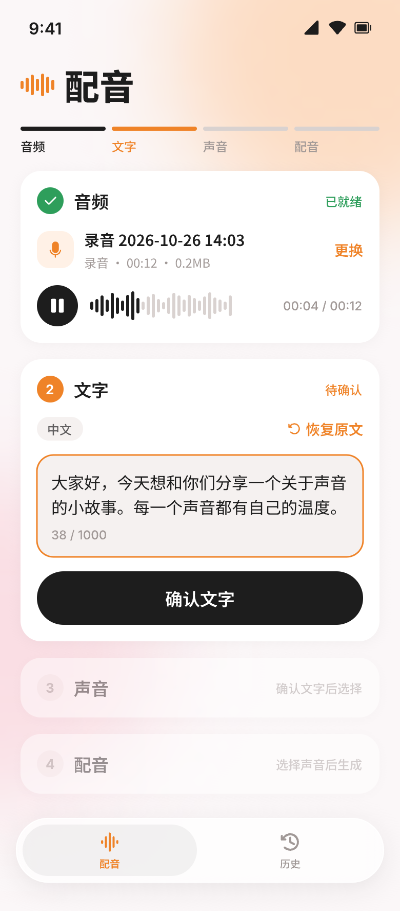
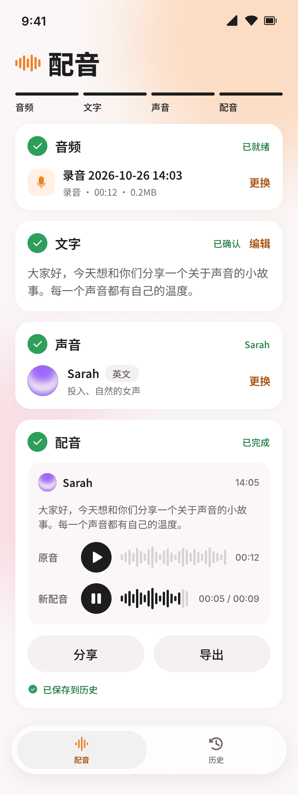
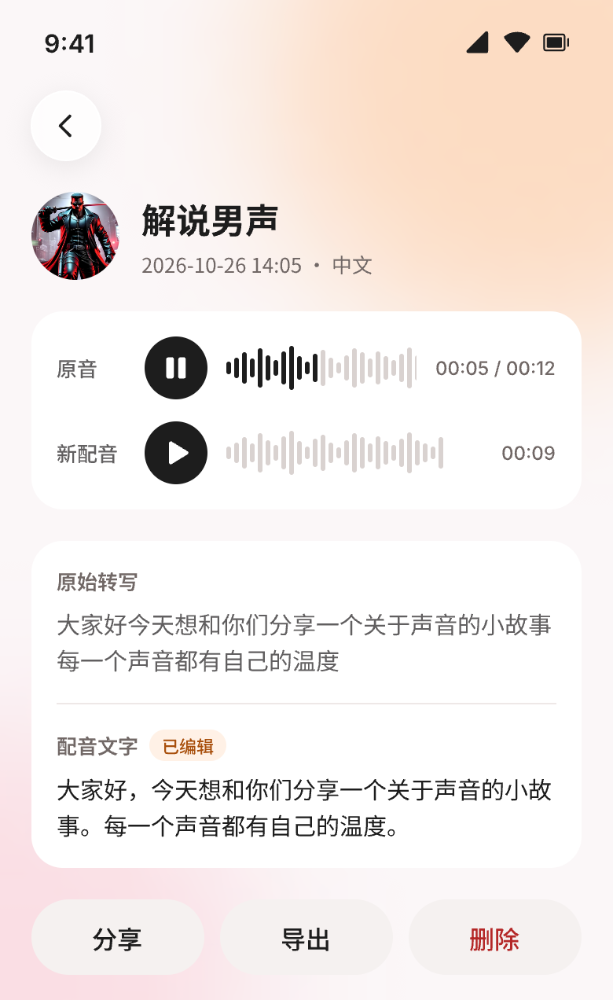

# Redub：录音转写与重新配音

基于 **Expo（SDK 58）+ React Native + TypeScript** 与 **Fish Audio API** 的移动端应用：录制或导入一段 1–60 秒的语音 → 转写为文字 → 检查并编辑 → 选择目标声音 → 生成新的配音 → 对比试听、导出与分享，成功记录自动保存到本地历史。

- 双端：iOS 与 Android 核心流程一致；iOS 26 使用系统液态玻璃（原生 Tab Bar、浮动弹层、玻璃按钮），其他系统自动降级。
- 视觉参考已上线的 Fish Audio App；界面为简体中文。

| 配音主流程 | 生成结果 | 声音选择 | 历史详情 |
|---|---|---|---|
|  |  |  |  |

> 以上为设计稿；真实运行效果见演示视频（交付材料）与 `docs/TEST_REPORT.md`。

---

## 1. 环境要求

| 项 | 版本 |
|---|---|
| macOS | 用于 iOS 构建（Xcode 26 及以上，含 iOS 26 模拟器） |
| Node.js | 22 LTS（npm 10） |
| Xcode | 26.x，CocoaPods 1.16+ |
| Android | Android Studio / Android SDK（compileSdk 36），JDK 17，模拟器 API 34+ |
| Fish Audio API Key | 用于转写（`/v1/asr`）与配音（`/v1/tts`） |
| 最低系统版本 | iOS 16.4；Android 7.0（API 24），SDK 58 默认值 |

> 项目使用了 `expo-audio`、`expo-glass-effect`、`expo-symbols` 等原生模块，需要**开发构建**（`expo run:*`），不能用 Expo Go 运行。

## 2. 安装与启动

```bash
git clone https://github.com/pan609/fish-redub.git
cd fish-redub
npm install
```

配置 API Key（`.env.local` 已被 `.gitignore` 忽略，不会提交）：

```bash
cp .env.example .env.local
# 编辑 .env.local，填入 EXPO_PUBLIC_FISH_API_KEY
```

启动（首次会执行 prebuild 生成原生工程并编译，耗时几分钟）：

```bash
npm run ios        # iOS 模拟器（等价于 npx expo run:ios）
npm run android    # Android 模拟器 / 已连接设备（等价于 npx expo run:android）
```

之后修改 JS 代码只需 `npm start` 启动 Metro，已安装的开发构建会自动连接。

**麦克风权限说明**：在 Mac 上用模拟器测试录音时，需要在"系统设置 → 隐私与安全性 → 麦克风"中允许模拟器访问麦克风，否则 iOS 模拟器无法开始录音、Android 模拟器可能退出。

## 3. 功能一览

| 模块 | 说明 |
|---|---|
| 录音 | 权限说明与拒绝后的"去设置开启"入口；计时与实时电平波形；60 秒原生上限自动结束；过短提示；预览、重录；录音中切后台自动结束并保留有效录音 |
| 导入 | 系统文件选择器导入 MP3 / WAV / M4A；按文件头校验真实格式；空文件、超过 10MB、时长不在 1–60 秒、损坏、伪装扩展名均有明确提示；取消选择不提示 |
| 转写与编辑 | 自动转写并识别语言；转写为空或明显无效（静音幻觉）时提示"未识别到有效语音"，可重录、重导入或手动输入；纯空白、超过 1000 字不能确认 |
| 声音与生成 | 4 个预置声音（中英各一男一女，头像与样例随包），点击即选中、可试听；请求锁定"确认后的文字 + 当前声音"快照；生成中 / 成功 / 失败 / 已过期状态清晰 |
| 试听与导出 | 原音与新配音分别播放、显示进度；全局同一时刻只有一个音源；iOS 系统分享面板（可"存储到文件"），Android 选择目录导出；取消不当作失败 |
| History | 每条记录包含：记录 ID、原音名称、原始转写、实际配音文字、目标声音、创建时间、原音与配音文件；重启后保留；详情对照、播放、分享、导出、删除 |
| 异常与重试 | 断网、超时（含响应体读取）、401、402、429（倒计时）、5xx、音频接收不完整、本地保存失败；可重试的错误一键重试，保存失败可"重试保存"且不重复请求 |

## 4. 项目结构

```
src/
├── app/            路由（expo-router）：Tab（配音 / 历史）、历史详情、录音与声音选择弹层、开发调试面板
├── features/       业务：redub（状态机与 store）、recorder、importer、history、debug（故障注入开关）
├── services/       Fish API 客户端（超时 / 取消 / 错误归一化 / TTS 完整性校验）、音频（单音源协调、时长探测、文件头识别）、存储（每条记录独立元数据）、导出
├── ui/             设计令牌、主题、组件（玻璃、按钮、步骤卡片、播放器等）
├── config/         环境变量读取、预置声音
└── copy/           界面与错误文案
assets/voices/      预置声音头像与试听样例
.maestro/           端到端测试流程
test-assets/        导入校验用测试音频（scripts/gen-test-assets.sh 生成）
docs/               PRD、DESIGN、PLAN、TEST_REPORT、多 Agent 协同记录与审查结果
design/             Pencil 设计稿与导出图
```

## 5. 测试

```bash
npm test             # 单元测试（87 条：状态机、请求守卫、存储协议与恢复、错误归一化、文件校验等）
npm run typecheck    # TypeScript 类型检查
npm run lint         # ESLint
```

端到端测试（Maestro）：准备测试音频后执行 `maestro test .maestro`，双端各 7 个流程全部通过。详见 [`docs/TEST_REPORT.md`](docs/TEST_REPORT.md) 与 [`.maestro/README.md`](.maestro/README.md)。

开发构建中长按配音页右上角的品牌标志可打开**故障注入面板**，模拟网络与存储层的各类异常（生产构建不包含该入口）。

## 6. 已知限制

- **API Key 在客户端**：按题目要求通过 `EXPO_PUBLIC_*` 环境变量注入，会被打包进安装包。正式产品应改为服务端代理签发短期凭证，因此**不要公开分发构建出的安装包**。
- **完整性校验的边界**：服务端未声明 `Content-Length` 且返回合法但被截短的 MP3 时，客户端无法识别；其余明显不完整的情况（断流、长度不符、空数据、非音频、无法解码）均会拦截。
- **转写有效性判断**：用"字数 ≤ 时长 × 25 字/秒"识别静音幻觉文本，极端快速的语速可能被误判为无效（仍可手动输入）。
- 仅适配手机竖屏；未实现登录、声音克隆、流式播放等题目明确排除的功能。

## 7. 开发过程文档

本项目按"产品设计 → UI 设计 → 编码 → 测试评测 → 优化 → 交付"分阶段推进，主力开发为 Claude Code，独立审查为 Codex，PM 负责裁决：

| 文档 | 内容 |
|---|---|
| [`docs/PRD.md`](docs/PRD.md) | 产品需求、状态机、异常处理、验收对照 |
| [`docs/DESIGN.md`](docs/DESIGN.md) | 视觉语言、设计令牌、组件、液态玻璃方案、图标规范 |
| [`docs/PLAN.md`](docs/PLAN.md) | 技术选型、架构、里程碑、原生能力验证、联调修复记录 |
| [`docs/TEST_REPORT.md`](docs/TEST_REPORT.md) | 测试策略、验收映射、执行结果、阶段四修复 |
| [`docs/COLLABORATION.md`](docs/COLLABORATION.md) | 多 Agent 协同与每轮审查的处理结论 |
| [`docs/PROGRESS.md`](docs/PROGRESS.md) | 阶段进度与日志 |
